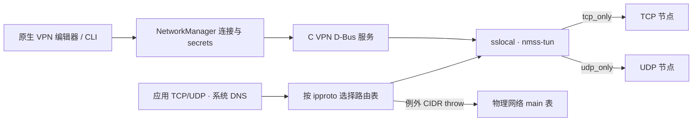

# 设计与验收

## 组件

`profile.c` 负责 JSON 解析、校验、节点导入、secrets 分离、NMConnection 转换和最小化后端配置；`routes.c` 生成可审查的策略路由计划；`runtime.c` 在工作线程启动后端并拥有路由和临时文件；`service.c` 继承 NMVpnServicePlugin，管理 D-Bus、异步激活、DNS 发布、取消和子进程退出；`nm-config.c` 生成包含用户指定 DNS 地址的 NM 配置；`editor-plugin.c` 提供不链接 GTK 的入口并按宿主加载 GTK 3/4 模块，`editor.c` 实现两版共用的原生界面（文件选择异步响应）；`cli.c` 提供导入、校验和连接管理。主插件产物均为 C 二进制/共享模块，`tools/update-routes.py` 是独立的 Python 标准库网段更新工具。



一个 sslocal 的两条服务器记录分别使用 `tcp_only` / `udp_only`，由 shadowsocks-rust 按协议选择节点，不进行跨协议故障转移。一个 TUN 接收两种协议，避免系统解析器绑定 VPN 接口时 UDP 无法进入对应后端。SO_MARK 0x5353 的后端出站连接先查 main 表；若 main 无路由则 unreachable，避免递归进入 TUN。目标 DNS IP 的 /32、/128 路由优先于例外 throw 网段。

## 路由与 DNS 生命周期

1. 以不可跟随符号链接的 root 锁排他运行，检查保留路由表、优先级和接口名空闲。
2. 在原网络解析节点域名，只向后端写入白名单节点字段、协议限制和固定 TUN 参数；通过 setpriv 以 shadowsocks 系统账户启动一个 sslocal，清除附加组，仅保留 CAP_NET_ADMIN 并设置 no_new_privs；混淆插件继承同一身份及能力。配置目录及文件仍由 root 持有，后端组只读。账户缺失或降权失败时不以 root 重试。
3. TUN 使用 `198.18.0.1/30` 和 `fd53:5353::1/126`。调整临时接口 MTU 和 rp_filter，不更改全局 sysctl。
4. 两个地址族的路由表全部建立后再安装策略规则。未启用地址族在协议表中使用 unreachable default。例外 throw 回落到 main。
5. libnm 直接发布用户指定的上游 DNS 地址，按 IPv4/IPv6 分组；不创建 DNS 监听器或转发进程。DNS 地址的主机路由强制进入 TUN。
6. libnm 发布 TUN、地址族与 DNS；NM 原有默认路由保持不变，负 DNS 优先级和 `~.` 选择 VPN 解析器。服务拥有策略表，NM 管理 VPN 地址和 DNS。
7. 断开时撤销策略规则和路由、终止后端、清除临时凭据；NM 自行撤销 VPN DNS。工作线程取消期间禁止新的激活，以防资源竞争。后端退出会使整个 VPN 失败并清理。

不承诺原子切换或断网保护：激活、断开期间可能使用原网络；运行中的单节点失效最终由子进程退出/应用超时暴露。TCP 与 UDP 的节点间没有自动故障转移。

## 异常终止恢复

SIGKILL 无法执行用户态清理。出现残留时先确认本插件服务和 sslocal 已停止，然后检查：

```sh
ip -4 rule show
ip -6 rule show
ip -4 route show table 51820
ip -4 route show table 51821
ip -6 route show table 51820
ip -6 route show table 51821
```

仅在确定这些保留资源属于本插件后，按 `nm-shadowsocks plan PROFILE.json` 的规则删除（将 `add` 改成 `del`），清空本插件的两个路由表。不要删除其他 VPN 的规则。TUN 一般随后端文件描述符关闭而销毁。锁文件本身可以保留，flock 在进程退出后自动释放。后续可扩展独立 watchdog/systemd 监督和带所有权日志的崩溃恢复。

## 测试与待验证项

大陆默认库随安装提供，不依赖用户寻找第三方列表。`tools/update-routes.py` 使用 `ipaddress` 将 APNIC CN 分配记录转换为双栈 CIDR，IPv4 支持非 2 的幂地址数量；下载器校验版本行、记录总数、双栈与 CIDR，再原子替换合并库。`regional.c` 只负责插件中的默认数据读取。读取优先级为用户更新库、系统更新库、随包快照。连接保存其选定数据，更新器不修改运行中的路由或旧连接；编辑器的“使用最新默认网段”可刷新旧连接。

Python 更新器测试覆盖非对齐 IPv4 范围拆分、IPv6 前缀、国家筛选、不完整文件拒绝、下载限制、HTTPS 重定向、原子写入、失败更新保留旧库和 gettext。C 的 `regional-data` 测试验证 Python 生成文件与插件默认库加载的兼容性、随包快照的双栈条数及 SHA-256。一项隔离网络测试安装完整随包大陆双栈列表并验证内核实际选路。

自定义区域使用两字母代码过滤 RIR 记录，支持逗号列表与重复参数。在线可选单一注册局或合并五个注册局，离线可提供多个不同注册局的文件；每份文件独立校验记录总数和版本号。RIR serial 作为不透明数字串保存，只有 APNIC 的日期格式额外校验日历合法性。地址族覆盖在所有源合并后按区域检查，自定义结果合并相邻网段，再检查插件可接受的最终条数。所有输入成功后才开始提交输出，任何源失败均保留旧合并文件。默认 CN/APNIC/双栈输出保持兼容，自定义结果要求显式目录并以区域命名。

ARIN 和 LACNIC 使用官方扩展统计格式。若源文件头部总数与正文记录数不符，更新器拒绝使用，不猜测缺失记录或放宽完整性校验。

Meson 的 GLib 单元测试覆盖 JSON 类型、独立节点、共用回退、危险导入字段、CIDR/DNS 校验、secrets 序列化、真实 libnm 连接校验、路由计划和导出权限。编辑模块加载、导入和导出测试不需要图形会话；GTK 创建与保存校验在临时 Xvfb 下执行。

`tests/run-netns.sh build/test-routes-live` 在独立 user/network namespace 创建临时 dummy 接口，实际安装与服务相同的批处理路由并查询内核选路。已验证双栈 TCP/UDP 分流、LAN/区域例外、DNS 强制走代理、全局模式、单地址族阻止、防回环和资源占用检查。它不验证真实 TUN 收发或远端代理协议。

`tests/run-netns.sh build/test-backend-live` 启动真实 sslocal/ssserver，用两套不同密钥和仅支持各自协议的节点验证 TCP/UDP 选择；并在移除 CAP_NET_BIND_SERVICE 后检查真实 TUN 启动。SOCKS 测试入口用于隔离验证同一后端服务器配置的协议选择，不等同于完整 TUN 端到端测试。系统解析器、NetworkManager 的完整联调仍在真实网络验收清单中。

真实网络验收需在虚拟机/隔离网络中执行，并为两条独立节点开启服务器日志：

- 用 TCP HTTP 和 UDP echo/QUIC 分别访问 IPv4、IPv6 目标，确认各自只出现在对应节点日志。
- 对全局、LAN、区域三模式验证应代理与应直连地址，包括额外 CIDR 和 DNS 落在例外段的情况。
- 用 `dig` / `dig +tcp` 验证对应节点；检查 `resolvectl status` / `nmcli device show` 和 VPN 断开后的 DNS 恢复。
- 单地址族模式检查另一族的非例外 TCP/UDP 被拒绝，LAN 例外仍按模式生效。
- 验证错误 2022 密钥、节点不可达、缺少 TUN 支持、端口/资源冲突、建立中取消、任一后端退出、SIGTERM、物理网络重连、服务 SIGKILL。
- 在 NetworkManager 安装目录实际加载插件，用 nm-connection-editor 新建/修改/导入/导出，再通过 nmcli 激活；检查密码只在 secrets 中。

本仓库不使用示例密码进行公网连接，不在开发主机自动安装或启用 VPN。未执行的真实网络验收不能视为通过。

参考：[libnm VPN 服务](https://networkmanager.dev/docs/libnm/latest/NMVpnServicePlugin.html)、[shadowsocks-rust](https://github.com/shadowsocks/shadowsocks-rust)、[Linux 策略路由](https://man7.org/linux/man-pages/man8/ip-rule.8.html)。

SIP003 节点字段在白名单清洗后保留，`plugin_opts` 和 `plugin_args` 随连接配置保存，避免宿主未加载 secrets 时编辑器丢失字段；兼容读取旧版 VPN secrets，配置中的值优先；GTK 3/4 同时提供编辑与导入。`plugin.c` 在激活时校验系统插件和管理员注册的额外程序，解析为可信绝对路径。运行时预解析服务器后重建路由计划，为插件端点添加双协议直连地址；独立 session 拥有后端及插件子进程，停止时整体清理。

降权测试 `test-backend-privileges` 验证后端及模拟插件子进程的 UID/GID、能力集合、不可恢复 root、配置只读和 SO_MARK。可在具有完整 subordinate UID/GID 映射的隔离环境运行：

```sh
unshare --user --map-root-user --map-auto --net build/test-backend-privileges --tun
```

`--tun` 还会启动真实 sslocal 验证 TUN 创建；该测试需已安装后端和系统账户，且仅应在独立网络命名空间运行。普通非 root 构建会跳过降权测试。

降权回归测试会先移除 CAP_CHOWN 和 CAP_SETPCAP 并重新执行，以模拟 NetworkManager 的 capability 限制。配置属组在 fork 后的子进程中切换有效 GID 后设置，避免依赖 CAP_CHOWN；不修改继承的 bounding set，执行后的 permitted/effective/inheritable/ambient 集合仅含 CAP_NET_ADMIN，并由 no_new_privs 阻止通过可执行文件获得额外权限。
